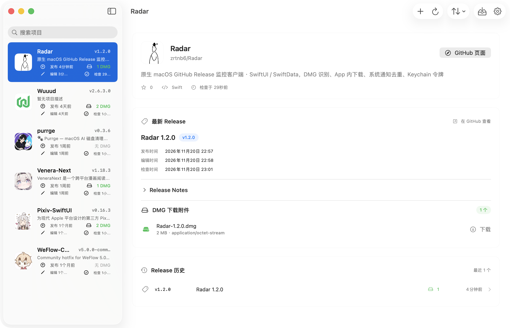
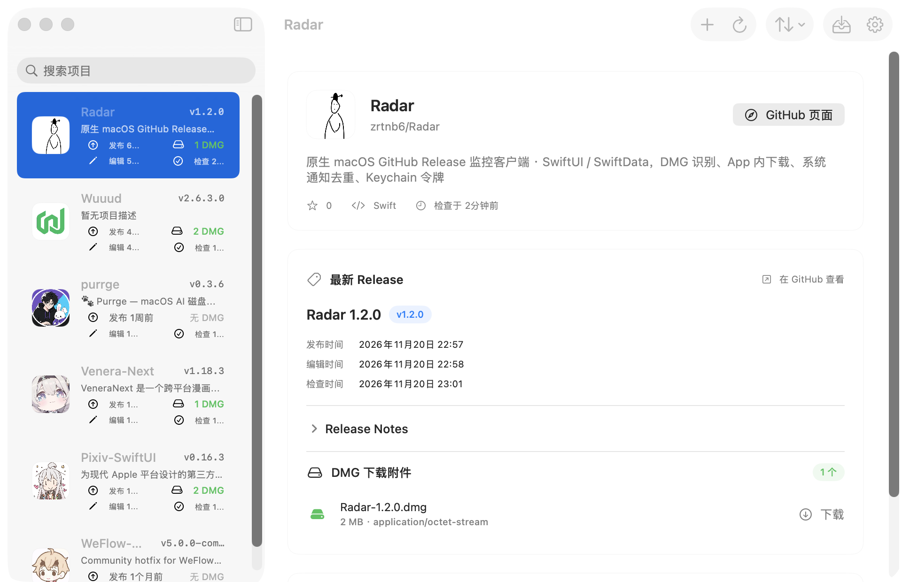

<div align="center">

# Radar

**原生 macOS GitHub Release 监控客户端**

监控 GitHub 仓库的新版本发布，识别 DMG 附件，App 内直接下载，发现新版本时推送系统通知。

[](#)
[](#)
[](#)
[](#测试)
[](LICENSE)

</div>

---

## 目录

- [截图](#截图)
- [功能特性](#功能特性)
- [安装](#安装)
- [首次安装的默认项目](#首次安装的默认项目)
- [使用流程](#使用流程)
- [GitHub 令牌（可选）](#github-令牌可选但建议配置)
- [附件下载](#附件下载)
- [隐私与安全](#隐私与安全)
- [架构与关键实现](#架构与关键实现)
- [工程结构](#工程结构)
- [从源码构建](#从源码构建)
- [测试](#测试)
- [已知限制](#已知限制)
- [许可证](#许可证)

## 截图





左侧项目列表是独立的一整块，边栏开关由系统放在标题栏最左侧，与窗口红绿灯同一条水平线；详情页展示最新 Release、可折叠的 Release Notes 与 DMG 附件。截图首位的 `zrtnb6/Radar` 即首次安装预置的默认项目，正监控 Radar 自己的 v1.2.0 发布。

## 功能特性

- **纯原生**：Swift / SwiftUI / SwiftData，无 Electron、Tauri 或 WebView 主界面
- **Release 监控**：自动拉取正式 Release，Draft / Prerelease 默认过滤（可选监控 Prerelease）
- **DMG 识别**：按文件扩展名识别 DMG 附件，大小写不敏感
- **App 内下载**：附件直链下载到 `~/Downloads`，行内进度、取消、重试，同名不覆盖
- **系统通知**：发现新版本 / 附件变化时推送，事件持久化去重，同一 Release 只提醒一次
- **首次添加即基线**：添加项目时对历史版本建立已读基线，不为旧版本轰炸通知
- **令牌支持**：GitHub Token 存入 Keychain，请求注入 Bearer；`GET /rate_limit` 一键验证配额
- **限流处理**：读取 `Retry-After` / `X-RateLimit-Reset`，限流窗口内自动暂停轮询
- **定时检查**：默认每 6 小时，可选 12 / 24 小时；启动后按最后检查时间补查
- **菜单栏入口**：`MenuBarExtra` 显示未读数，快捷查看与刷新
- **开机自启**：通过 `SMAppService` 管理，设置里一键开关

## 安装

从 [Releases](https://github.com/zrtnb6/Radar/releases) 或仓库内 [`dist/Radar-1.2.0.dmg`](dist/Radar-1.2.0.dmg) 下载（2.0 MB，1,987,765 字节，Universal `x86_64` / `arm64`，macOS 14.0+）。

1. 双击 DMG 挂载，把 `Radar.app` 拖入 `Applications`，然后推出镜像。
2. **首次打开**：应用使用本地 ad-hoc 签名、未做 Developer ID 签名与公证，Gatekeeper 会拦截。在 Finder 中右键点击 App → 「打开」→ 再点「打开」；或在「系统设置 → 隐私与安全性」中点「仍要打开」。只需一次。
3. **升级安装**：先退出应用，将新版拖入 `Applications` 并选择「替换」；已添加的仓库、Token 与设置都保留在本地（SwiftData 容器 + Keychain）。

## 首次安装的默认项目

首次安装并启动后，项目列表会自动出现一个默认项目 **[`zrtnb6/Radar`](https://github.com/zrtnb6/Radar)** —— Radar 监控它自己，既是开箱即用的示例，也能直接收到 Radar 自身的新版本提醒。

这一行为的设计细节：

- **本地写入，不依赖网络**：默认项目直接写入 SwiftData，离线安装也能立刻看到；联网后由常规刷新补齐头像、Star 数与 Release 列表。
- **首次刷新只建立基线**：默认项目第一次被检查时，已有的历史 Release 全部标记为已读，不会推送任何通知；之后的真正新版本才会提醒。
- **可删除，且不会复活**：右键删除默认项目后，重启应用也不会重新出现（一次性标记保存在 UserDefaults）。
- **升级用户不受影响**：已经添加过项目的用户不会被强行塞入这个默认项目。

## 使用流程

1. 点击工具栏 `+` 或按 `⌘N`。
2. 粘贴仓库链接，例如 `https://github.com/owner/repository`、`/releases` 或 `/releases/tag/version`。
3. Radar 自动解析 Owner/Repository，查询仓库、正式 Release 与附件，并建立「已读」基线。
4. 后续检查发现新 Release 时写入本地缓存、显示未读标记并发送系统通知；点击通知直接跳到对应 Release。
5. 点击附件右侧的「下载」，App 在内建下载器中直接拉取直链并保存到 `~/Downloads`，不跳转浏览器。
6. Release Notes 默认折叠，点标题左侧三角展开；切换项目自动收起。

## GitHub 令牌（可选，但建议配置）

GitHub REST API 对**未认证请求**按来源 IP 限流为 **60 次 / 小时**；使用有效令牌后按令牌计，核心 API 为 **5000 次 / 小时**。每个仓库每次检查约 2 次请求（仓库信息 + Release 列表），监控 10 个仓库一次全量刷新就约占 20 次匿名配额，很容易触发限流。

配置路径：**设置 → GitHub 令牌**。

- 在 GitHub 创建 [Fine-grained PAT](https://github.com/settings/personal-access-tokens)（设置页内有直达链接），粘贴后点「保存令牌」。
- 点「验证令牌 / 查看配额」会调用 `GET /rate_limit`（不消耗配额），`limit` 从 60 变为 5000 即表示令牌生效。
- 令牌保存在系统 Keychain，不写入数据库、日志或 UserDefaults；保存后立即生效，无需重启。
- 公开仓库**仍可不填令牌**；令牌只提升 API 限额，访问私有仓库还需令牌具备对应仓库的读取权限。
- 遇到限流或 401 时，错误提示会直接指引到该设置项。

## 附件下载

- **手动触发**：只有点击才会下载；刷新或启动时不会自动下载，也不会自动打开、安装或执行下载内容。
- **进度与取消**：附件行内显示进度条与百分比，可随时取消；失败时显示原因并提供「重试」。
- **同名不覆盖**：目标文件已存在时自动追加 ` 2`、` 3` 后缀。
- **完成后**：附件行显示「已下载」，可点「在 Finder 中显示」定位文件。
- **下载中心**：工具栏「下载」按钮查看全部任务，按钮上显示进行中数量；完成的任务收为单行。
- **地址校验**：只接受 `https://github.com` 直链，拒绝 `http`、其它域名、带账号密码的 URL；文件名去掉路径分隔符与控制字符，防止路径穿越。
- **令牌不外发**：下载请求不携带 GitHub Token，避免认证头被带到重定向后的 CDN；因此当前直链下载面向公开仓库附件。
- **沙箱权限**：启用 App Sandbox，仅为写入「下载」文件夹申请 `com.apple.security.files.downloads.read-write`。

## 隐私与安全

- Token 仅存 Keychain，不写日志、数据库或 UserDefaults
- 不读取 Star 列表，不自动下载或安装 DMG，不执行 Release 中的任何脚本
- 所有 GitHub 访问走 HTTPS REST API（`api.github.com`），不做高频轮询
- 全部数据（仓库、Release、附件、通知事件）保存在本地 SwiftData，无遥测、无账号体系

## 架构与关键实现

| 能力 | 实现 |
| --- | --- |
| 数据持久化 | SwiftData：`Repository`、`Release`、`Asset`、`NotificationEvent` |
| GitHub 访问 | `URLSession`，REST API `v2022-11-28`，HTTPS，30 秒超时 |
| GitHub 令牌 | Keychain 存取 + 每次请求注入 `Bearer`；`GET /rate_limit` 校验配额 |
| URL 解析 | 仅接受 `github.com` 仓库首页、`/releases`、`/releases/tag/...` |
| DMG 识别 | 文件名扩展名，大小写不敏感，不依赖 Content-Type |
| 更新判断 | Release ID、Tag、发布时间、Prerelease→正式状态变化；忽略仅 Notes 编辑 |
| 通知去重 | 持久化 `NotificationEvent`，同一 Release 只创建一次事件 |
| 并发控制 | 每批最多 3 个仓库，单仓库失败隔离并保留缓存 |
| 定时检查 | 默认 6 小时，可选 12 / 24 小时；启动后按最后检查时间补查 |
| 限流处理 | 读取 `Retry-After` / `X-RateLimit-Reset`，限流窗口内暂停轮询并引导配置令牌 |
| 默认项目 | 首次安装本地预置 `zrtnb6/Radar`（见[上文](#首次安装的默认项目)），首次刷新按基线处理 |
| 原生系统集成 | `NavigationSplitView` 两栏布局、`MenuBarExtra`、`UserNotifications`、`SMAppService` |

## 工程结构

```text
Radar/
├── Sources/
│   ├── App/                    # App 入口、全局状态、设置项
│   ├── Models/                 # SwiftData 数据模型
│   ├── Services/
│   │   ├── GitHub/             # DTO、客户端、URL 解析、配额、错误
│   │   ├── Download/           # 下载地址策略与 App 内下载器
│   │   ├── Release/            # DMG 与更新检测
│   │   ├── Sync/               # 添加、刷新、持久化、自动检查调度
│   │   ├── Notification/       # 通知授权、去重投递、点击处理
│   │   ├── Persistence/        # ModelContainer、默认项目预置、Debug 夹具
│   │   └── Security/           # Keychain
│   ├── DesignSystem/           # Spacing / Typography / Color / 通用组件
│   ├── Features/               # 列表、详情、下载中心、添加、设置、菜单栏
│   └── Utilities/
├── Tests/                      # 47 项单元 / 集成测试
├── Resources/Assets.xcassets/  # AppIcon
├── Documentation/
│   ├── GenerateIcon.swift      # App 图标生成脚本（swiftc 可直接编译运行）
│   └── screenshots/            # README 截图
├── dist/                       # 交付物（仓库内仅保留当前版本 DMG）
└── ReleaseRadar.xcodeproj      # Xcode 工程（target 名沿用 ReleaseRadar，产物名 Radar.app）
```

## 从源码构建

要求：Xcode 15+（建议最新版），macOS 14+。

```bash
git clone https://github.com/zrtnb6/Radar.git
cd Radar
open ReleaseRadar.xcodeproj
```

或使用命令行构建：

```bash
xcodebuild \
  -project ReleaseRadar.xcodeproj \
  -scheme ReleaseRadar \
  -configuration Release \
  -destination 'platform=macOS' \
  -derivedDataPath DerivedData \
  build
```

产物位于 `DerivedData/Build/Products/Release/Radar.app`。工程使用本地 ad-hoc 签名；正式公开分发需要在 Xcode 中配置开发者团队并完成 Developer ID 签名与公证。

DMG 可用系统自带工具重新生成：

```bash
mkdir -p dmg-staging
ditto --noqtn DerivedData/Build/Products/Release/Radar.app dmg-staging/Radar.app
xattr -cr dmg-staging/Radar.app
ln -s /Applications dmg-staging/Applications
hdiutil create -volname "Radar" -srcfolder dmg-staging -ov -format UDZO -fs HFS+ dist/Radar-1.2.0.dmg
```

App 图标由 `Documentation/GenerateIcon.swift` 程序化生成（纯深蓝底 + 两道扫描弧 + 命中点），修改后编译运行即可重新输出 1024×1024 主图，再按 `Resources/Assets.xcassets/AppIcon.appiconset/Contents.json` 的尺寸表缩放。

## 测试

测试不依赖真实 GitHub Token，使用 `URLProtocol` 模拟网络，并直接验证真实 SwiftData 容器。

```bash
xcodebuild test \
  -project ReleaseRadar.xcodeproj \
  -scheme ReleaseRadar \
  -configuration Debug \
  -destination 'platform=macOS' \
  -derivedDataPath DerivedData \
  -resultBundlePath TestResults.xcresult
```

最近一次结果：**47 / 47 通过，0 失败**（macOS 26.7.3，Xcode 26.5，x86_64）。

覆盖范围：

- GitHub URL 的合法变体、非法协议 / 域名 / 多余路径
- REST 仓库与 Release 解码、公开请求无 Token、Token 请求头
- 401 / 403 / 404 / 429 / 5xx、`Retry-After`、`X-RateLimit-Reset`
- DMG 扩展名大小写、多 DMG、伪后缀、无 DMG、空 Release
- Draft / Prerelease 过滤、发布时间排序
- 首次添加基线、重复仓库不重复插入
- Release ID / Tag / 发布时间 / Prerelease 状态变化检测；Notes 编辑不触发新版本
- 通知事件去重、Release / Asset 缓存不重复
- 网络失败保留缓存、持久化跨容器读取、多仓库刷新最多 3 个并发
- `GET /rate_limit` 解码、配额请求绕过本地 URLCache、401 映射
- 下载地址校验、附件文件名清理、同名不覆盖、真实下载流程、失败与重试
- 默认项目：空库注入、幂等、已有数据不注入、清空后不复活、首次刷新只建基线不通知

## 已知限制

- 每个仓库最多拉取最近 30 个 Release 用于缓存，界面历史区域展示最近 10 个；未实现分页「加载更多」。
- 私有仓库仅支持手动配置 Fine-grained PAT，未支持登录设备流；访问私有仓库需令牌具备对应仓库的 `Contents` / `Metadata` 读取权限。
- 本地构建为 ad-hoc 签名，不包含 Apple 公证；`spctl -a -t install` 返回 `rejected` 属预期，按安装说明右键打开即可。
- 附件只在用户点击时下载；不自动下载、打开、安装或执行下载内容，也不提供自动更新器。
- 内建下载器只接受 `https://github.com` 直链，面向公开仓库附件；私有仓库附件下载未实现。
- 不做断点续传与后台会话：关闭窗口不影响下载，退出 App 会中断进行中的任务。

## 许可证

本项目基于 [MIT License](LICENSE) 开源。

## 作者

**zrtnb6** · [GitHub](https://github.com/zrtnb6)
